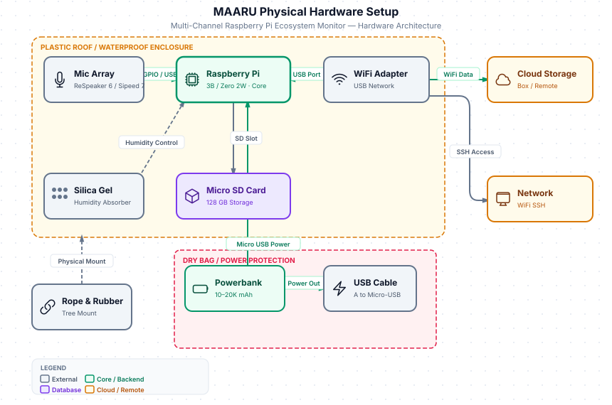
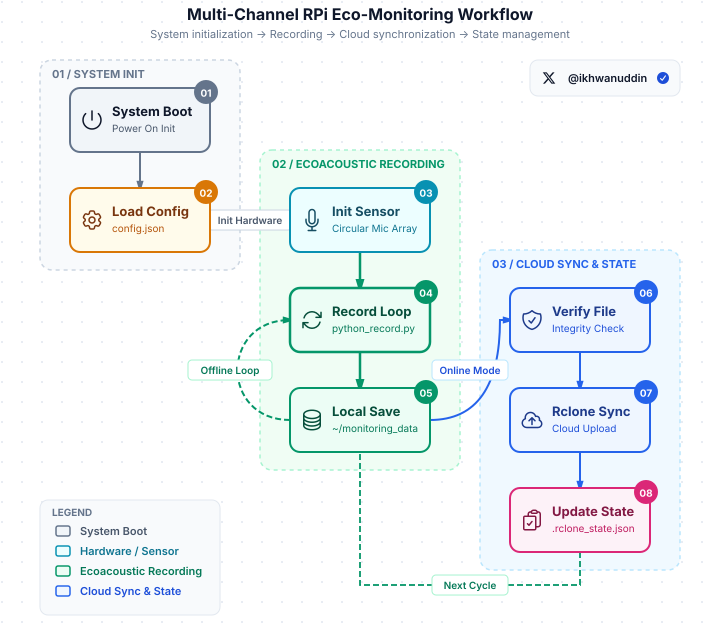

# System Architecture & Workflow

Overview of how the multi-channel ecosystem monitoring system works.

## Physical Hardware Setup

MAARU (Multichannel Acoustic Autonomous Recording Unit) is a rugged ecosystem monitoring system; this fork's hardware notes describe a build for tropical rainforest environments. The diagram below shows the physical hardware layout, weatherproofing layers, and how components connect to each other.



> **Tip**: The diagram scales with the page width. The editable source is [maaru-physical-setup.af](./maaru-physical-setup.af) (Affinity Designer).

### Nested Architecture Layers

#### **Layer 1: Waterproof Roof**
- **Function**: Protects against direct rainfall over the main enclosure
- **Material**: Recycled plastic container
- **Protection**: Water runoff to sides, extends enclosure lifespan

#### **Layer 2: Main Enclosure (Food Container)**
Core components protected from direct weather:

- **Raspberry Pi** (tested: Zero 2 W, 3B+, 4B)
  - Compute core for the system
  - Larger models: more RAM and CPU headroom
  - Pi Zero 2 W: lower power, cheaper; the runtime tuning (rclone limits, GC thresholds) targets its 512 MB RAM

- **Microphone Array Sensor** (choose one)
  - **ReSpeaker 6-Mic Array** (legacy) → connected via **GPIO pins**
    - 6 channel simultaneous recording
    - Lower power consumption (~0.5A)
    - Direct I2S connection
  - **Sipeed 6+1 Mic Array on the MA-USB8 board** → connected via **USB port**
    - 8 channel recording: CH0–CH5 ring mics, CH6 beamformed output, CH7 centre mic ([Sipeed wiki](https://wiki.sipeed.com/hardware/en/modules/micarray_usbboard_bl616.html))
    - Powered via USB
    - Better for modularity

- **Micro SD Card**
  - Local storage for audio files (.FLAC)
  - Class 10, minimum 150 MB/s
  - Capacity: 64GB-256GB (depends on retention policy)

- **USB WiFi Adapter**
  - Wireless network connectivity
  - For SSH access from mobile/computer
  - For cloud storage upload (optional)
  - Powered from Pi USB port

- **Silica Gel**
  - Absorbs ambient moisture in tropical rainforest environment
  - Essential for preventing condensation inside enclosure
  - Replace every 1-2 weeks or when saturated

- **IP68 Acoustic Membrane**
  - Specialized layer at microphone holes
  - Water-resistant (IP68 rated)
  - Maintains acoustic transparency

- **Silicon Sealant**
  - Seals all cable holes
  - Prevents water ingress

#### **Layer 3: Dry Bag (Power Protection)**
- **Function**: Protects powerbank from moisture and water damage
- **Location**: Outside main enclosure, within plastic roof
- **Contents**: Powerbank supplying power to Pi
- **Connection**: USB Cable (USB-A to Micro-USB) to Pi power port

### Physical Connections & Power Flow

| Component | Connected to | Interface | Power (A) | Notes |
|-----------|-------------|-----------|----------|-------|
| **Mic Sensor** | Raspberry Pi | GPIO (ReSpeaker) or USB (Sipeed) | 0.3-0.8 | Choose one |
| **USB WiFi** | Raspberry Pi | USB Port | 0.2-0.5 | Optional, for network |
| **Micro SD** | Raspberry Pi | SD Card Slot | 0.1 | Local storage |
| **Powerbank** | Raspberry Pi | Micro USB Power | Vout=5V | Primary power supply |
| **Silica Gel** | Environment | Humidity control | N/A | Passive, absorbs moisture |

### Mounting & Environmental Protection

- **Rope & Rubber**: Tethered to tree for stability and fall prevention
- **Food Container + Plastic Roof**: Protection from extreme weather (rain, UV, insects)
- **Silica Gel**: Humidity control in tropical rainforest environment
- **IP68 Membrane**: Protects acoustic holes from water ingress

### External & Cloud

- **Cloud Storage (Box)**: Destination for audio files uploaded via rclone
- **Network Access**: SSH via USB WiFi adapter (if connected)

---

## System Components (Software)

This section describes the software components running on MAARU:

```
┌───────────────────────────────────────────────────────────────┐
│                         Raspberry Pi                          │
├───────────────────────────────────────────────────────────────┤
│                                                               │
│  ┌──────────────┐      ┌──────────────┐   ┌──────────────┐    │
│  │   Sensor     │      │  record.py   │   │ rclone_      │    │
│  │ (Sipeed      │──→   │  arecord +   │──→│ upload.sh +  │    │
│  │  MA-USB8)    │      │  ffmpeg      │   │ state_manager│    │
│  └──────────────┘      └──────────────┘   └──────────────┘    │
│        │                      │                    │          │
│        USB/GPIO               │               Network         │
│                         Local Storage            (optional)   │
│                         .FLAC files                           │
│                                                               │
│  ┌──────────────┐      ┌──────────────┐   ┌──────────────┐    │
│  │  config.json │      │ eco-monitor  │   │   Logs       │    │
│  │              │──→   │ .service     │──→│              │    │
│  │              │      │ (systemd)    │   │              │    │
│  └──────────────┘      └──────────────┘   └──────────────┘    │
│                                                               │
└───────────────────────────────────────────────────────────────┘
         │
         ├─→ Recordings: /home/pi/monitoring_data/live_data/RPiID-<serial>/
         ├─→ Config: ~/multi-channel-rpi-eco-monitoring/config.json
         └─→ Logs: ~/multi-channel-rpi-eco-monitoring/logs/logfile.log + journald
```

---

## Boot Sequence

When the Raspberry Pi starts, systemd runs `eco-monitor.service` (installed by `installer.py`, runs as the installing user, normally `pi`). No auto-login or `/etc/profile` entry is used.

1. **ExecStartPre steps** (in order)
   - Restore the clock from `/etc/fake-hwclock.data`
   - `update_time.sh`: NTP if online, otherwise the WiFi gateway (`offline_time_sync.py`); failure is allowed
   - `discover_serial.py` writes `PI_ID=RPiID-<cpu serial>` to `/tmp/eco-monitor-pi-id.env`
   - `check_fs_expanded.sh`: one-time `raspi-config --expand-rootfs` if the root partition is under 90% of the card
   - `led_off.sh`: Sipeed board LEDs off; then the Pi's ACT LED off
   - `sync_rclone_config.sh`: pull/push `rclone.conf` from/to the GitHub Gist (if configured)

2. **`record.py`** (`ExecStart`)
   - Auto-update: `git checkout master`, `git fetch origin`, `git reset --hard origin/master`, `git clean -fd` (keeps `config.json` and `logs/`), then `systemctl daemon-reload`
   - Loads `config.json`, sets up the sensor, drains any pending WAV files (compresses them)
   - Starts the recording thread, the scheduled-reboot thread and, if enabled, the upload thread

3. **Restart policy**: `Restart=always`, `RestartSec=5`

`wifi-field-timer.service` (optional) starts independently and does not delay recording.

---

## Recording Workflow

### Workflow Overview



(The diagram predates the systemd service; some labels use old names such as `python_record.py` and `.rclone_state.json`. The text below is current.)

### Offline (no internet reachable, or `upload_enabled: false`)

```
┌──────────────────────┐
│ Boot / service start │
└──────┬───────────────┘
       │
       ↓
┌──────────────────────┐
│ Load config.json     │
│ Initialize sensor    │
└──────┬───────────────┘
       │
       ↓
┌──────────────────────────────┐
│ Compress pending WAVs        │
│ (pre_upload_dir → live_data) │
└──────┬───────────────────────┘
       │
       ↓
┌──────────────────────┐
│ Storage check        │
│ arecord, 8 ch,       │
│ 16 kHz, S16_LE,      │
│ record_length 1200 s │
└──────┬───────────────┘
       │
       ↓
┌──────────────────────────────┐
│ WAV → pre_upload_dir         │
│ next loop: ffmpeg → FLAC in  │
│ live_data/RPiID-<serial>/    │
└──────┬───────────────────────┘
       │
       ↓
┌──────────────────────┐
│ Sleep capture_delay  │
│ (300 s, powersave)   │
└──────┬───────────────┘
       │
       └─→ Repeat
```

### Online (`upload_enabled: true`, `test_mode: 0`, internet reachable)

```
┌──────────────────────┐
│ Internet detected    │
│ → recording paused   │
└──────┬───────────────┘
       │
       ↓
┌──────────────────────┐
│ update_time.sh       │
└──────┬───────────────┘
       │
       ↓
┌──────────────────────┐
│ Pre-verify remote,   │
│ mark files uploading │
└──────┬───────────────┘
       │
       ↓
┌──────────────────────┐
│ rclone copy          │
│ (3 attempts)         │
└──────┬───────────────┘
       │
       ↓
┌──────────────────────┐
│ Upload Success?      │
├──────┬───────────────┤
│ YES  │     NO        │
│      │               │
│ Verify  Keep local   │
│ on      Retry next   │
│ remote, cycle        │
│ delete               │
│ local                │
└──────┴───────────────┘
```

Recording resumes when internet is no longer reachable.

---

## Core Scripts

### 1. `eco-monitor.service`

**Purpose**: systemd unit template; `installer.py` replaces `__REPO_DIR__` and `__SERVICE_USER__` and installs it to `/etc/systemd/system/`

**Flow**: runs the `ExecStartPre` steps above, then `python3 -u record.py <repo>/config.json logfile.log logs`, and restarts it if it exits

---

### 2. `record.py`

**Purpose**: Main recorder

**Key Functions**:
- `auto_update_repository()`: force-sync to `origin/master`
- `continuous_recording()`: record loop, pauses while online, storage check, tiny-file reboot (3 in a row)
- `run_postprocess()`: stage WAVs from `tmp_dir` to `pre_upload_dir`, call `sensor.postprocess()` (FLAC)
- `upload_server_sync()`: upload thread, runs `update_time.sh` and `rclone_upload.sh`
- `scheduled_reboot_monitor()`: daily reboot at `reboot_time` / `reboot_time_2`, deferred while recording
- `set_cpu_governor()`, `gc_and_log_memory()`: power and memory housekeeping

**Key Classes**:
- `MinuteBoundaryFormatter`: Prefix logs with timestamp only when minute changes
- Sensor classes (in `sensors/`): `Sipeed7Mic`, `Respeaker6Mic`, `Respeaker4Mic`, `Respeaker_Custom`, `UnixDevice`

**Logs to**: `logs/logfile.log` and stdout (journal)

---

### 3. `rclone_upload.sh` + `state_manager.py`

**Purpose**: Uploads recorded files to cloud storage

**Flow**:
1. `state_manager.py pre-verify`: files already on the remote are marked `completed`
2. `state_manager.py init-scan-mark`: all local `.flac`/`.wav` not yet completed are marked `uploading`
3. `rclone copy --files-from -` to `<remote>:monitoring_data/RPiID-<serial>/` (retries on exit codes 3–9)
4. `state_manager.py verify-finalize`: files listed on the remote are marked `completed` and deleted locally
5. Push `rclone.conf` to the Gist (at most once per hour)

**Called by**: `record.py` upload thread

**Logs to**: stdout (captured into `logfile.log` with `[upload]` prefix) and `/home/pi/monitoring_data/live_data/rclone.log`

---

### 4. `installer.py`

**Purpose**: Interactive installer (replaces the former `setup_config.py`); must run with `sudo`

**Menu**:
1. Configure sensor & generate `config.json`
2. Install `eco-monitor.service`
3. Configure GPIO shutdown button (`dtoverlay=gpio-shutdown`)
4. Install shell shortcuts into `~/.bashrc`
5. Full setup (1 → 2 → 3 → 4, then the WiFi timer)
6. Migrate from legacy `/etc/profile` startup
7. Migrate `config.json` to the latest schema
8. Show current status
9. Enable / manage field WiFi timer

**Output**: `config.json`, systemd units, boot config overlay, `.bashrc` shortcuts. It does not install apt packages.

---

## Data Flow

### File Naming Convention

```
/home/pi/tmp_dir/2026-07-01/14-24-03_dur=1200secs.wav        # while recording
/home/pi/pre_upload_dir/2026-07-01/14-24-03_dur=1200secs.wav # finished, waiting for compression
/home/pi/monitoring_data/live_data/RPiID-<serial>/
├── 2026-07-01/
│   ├── 14-24-03_dur=1200secs.flac    # HH-MM-SS_dur=<record_length>secs
│   ├── 14-49-10_dur=1200secs.flac
│   └── ...
└── logs/
```

The date folder plus start time makes chronological ordering trivial. A failed recording leaves `<name>_ERROR_audio-record-failed` in `pre_upload_dir` with the `arecord` details.

### File Size Factors

| Factor | Typical Value | Impact |
|--------|---------------|--------|
| Channels | 8 (Sipeed) | Fixed per sensor |
| Sample Rate | 16,000 Hz | Fixed in sensor class |
| Bit Depth | 16 bits | Fixed in sensor class |
| Duration | 1,200 sec (20 min) | `record_length` |
| Codec | FLAC | `compress_data` |

**WAV size**:
```
Size = sample_rate × channels × bit_depth / 8 × duration
     = 16,000 × 8 × 2 × 1,200
     ≈ 307 MB per 20-minute WAV (FLAC is smaller; ratio depends on content)
```

---

## Configuration Cascade

When the system starts, it reads settings in this order:

1. **Default values** (hardcoded in sensor classes and `record.py`)
2. **config.json** (user configuration)
3. **Environment variables**: `PI_ID` (set by the service) and `FORCE_OFFLINE_MODE` (disables uploads)

Each level overrides the previous one. `record.py` takes exactly three positional arguments (config path, log file name, log dir) and has no other command-line options.

---

## Sensor Integration

### Adding a New Sensor

To support a new microphone array:

1. Create new class in `sensors/NewSensor.py`, following `Sipeed7Mic.py`:
   ```python
   class NewSensor(SensorBase):
       def __init__(self, config=None):
           # read options with sensors.set_option(); set server_sync_interval

       @staticmethod
       def options():
           # list of {name, type, default, prompt} used by installer.py

       def setup(self):
           # return True when ready

       def capture_data(self, working_dir, upload_dir, pre_upload_dir):
           # record one file into pre_upload_dir

       def postprocess(self, wfile, upload_dir):
           # compress/move one WAV into upload_dir, return True on success
   ```

2. Register in `sensors/__init__.py`:
   ```python
   from sensors.NewSensor import NewSensor
   ```

3. The installer lists every class in `sensors` automatically (except `SensorBase`)

4. Test by selecting it in `sudo python3 installer.py` (menu 1) and restarting the service

---

## Error Handling Strategy

### Recording Errors

| Error | Cause | Recovery |
|-------|-------|----------|
| OVERRUN | Audio buffer full, samples lost | Logged as `arecord stderr`; upgrade SD card / power |
| Device not found | Sensor disconnected | Error marker written; after 3 failed/tiny recordings in a row the Pi reboots |
| `arecord` hangs | USB / driver stall | Killed after `max(1.75 × record_length, record_length + 180)` s |
| Disk low | No space left | Warning below 4 GB, safe shutdown below 1 GB; no automatic deletion |
| Unhandled exception | Any | Logged with traceback, loop continues after 5 s; systemd restarts the process if it exits |

### Upload Errors

| Error | Cause | Recovery |
|-------|-------|----------|
| Connection timeout | Network down | Keep local file, retry next cycle |
| Auth failed | Credentials expired | Re-authenticate, continue |
| Thread stall | Unknown | `WATCHDOG` error logged after `3 × sync interval + 300` s |

**Strategy**: Persist failed files, retry on next cycle; within a cycle `rclone copy` is retried up to 3 times with exponential backoff (10 s, 20 s)

---

## Performance Characteristics

### CPU Usage

- **Idle**: CPU governor `powersave` between recordings
- **Recording**: `arecord`, then `ffmpeg` FLAC compression, governor `ondemand`
- **Upload**: rclone with 2 transfers, 4 checkers, 4 MB buffer

### Memory Usage

- Python garbage collection runs when the process exceeds 120 MB RSS, or every 12th cycle
- rclone settings keep peak buffer use around 8 MB

Tuned for Pi Zero 2 W (512 MB) and larger models.

### Network Bandwidth

**Upload speed** (typical):
- 300 MB file over 1 Mbps connection ≈ 40 minutes
- Same file over 10 Mbps connection ≈ 4 minutes

**Optimize**:
- Keep FLAC compression on
- Use faster internet (wired > WiFi)
- Remember recording is paused while uploading

---

## Logging Architecture

`record.py` logs plain messages with a `[YYYY-MM-DD HH:MM]` prefix whenever the minute changes. Helper scripts add their own prefixes (`[upload] [upload:<phase>]`, `[gist-sync]`, `[wifi-field-timer]`).

This enables:
- **Easy filtering**: `grep "\[upload:error\]"`
- **Component isolation**: `grep "\[upload"`
- **Timeline reconstruction**: `journalctl -u eco-monitor.service -o short-iso`

See [log_guide.md](log_guide.md) for details.

---

## State Persistence

### Configuration State
- **File**: `config.json`
- **Scope**: Recording parameters, upload settings
- **Persistence**: Survives reboots and auto-update (git-ignored, excluded from `git clean`)
- **Frequency**: Loaded once at startup

### Upload State
- **File**: `/home/pi/monitoring_data/live_data/rclone_state.json`
- **Scope**: Which files are pending, uploading or completed
- **Persistence**: Survives reboots (atomic write via temp file + rename)
- **Frequency**: Updated at each upload cycle

### Boot State
- **Location**: `/etc/systemd/system/eco-monitor.service`, `wifi-field-timer.service`, boot `config.txt` overlay, `/home/pi/.fs_expanded` marker
- **Scope**: Service start, GPIO button, filesystem expansion
- **Persistence**: Survives reboots
- **Frequency**: Applied at boot

---

## Shutdown Procedure

### Graceful Shutdown

1. **User action**: Press button (`gpio-shutdown` overlay) or run `sudo shutdown -h now`
2. **Signal received**: systemd stops `eco-monitor.service` (SIGTERM)
3. **Recording stopped**: the current `arecord` file is left unfinished in `tmp_dir`
4. **Uploads stopped**: an in-progress upload is interrupted
5. **System halts**: Kernel cleanly unmounts filesystems

On the next start, `run_postprocess()` moves leftover WAVs from `tmp_dir` to `pre_upload_dir` for compression (files under 1 MB are discarded) and removes orphaned `.tmp` files from interrupted compression.

`record.py` itself also calls `sudo shutdown -h now` when free space falls below `min_free_storage_gb`, or (ReSpeaker, `use_system_shutdown_button: 0`) when the GPIO 26 button is pressed.

### Emergency Shutdown

If power loses unexpectedly:
1. The file being recorded may be incomplete
2. Uploads may be partial
3. State tracking continues on next boot
4. The pre-verify step prevents re-uploading files already on the remote

---

## Deployment Models

### Single Device Offline

```
Pi → SD Card (Local Storage)
```

Best for: Site characterization, temporary surveys. Set `upload_enabled: false`, or simply deploy without a known WiFi network.

### Single Device Online

```
Pi → SD Card → Rclone → Cloud Storage (Box/Drive)
```

Best for: Units that come back in range of WiFi (base camp, phone hotspot); remember recording pauses while online

### Multi-Device Parallel

```
Pi #1 ──┐
Pi #2 ──→ Shared remote, one RPiID-<serial> folder per Pi
Pi #3 ──┘
```

Best for: Ecosystem-wide monitoring, multiple locations. The Gist sync keeps one `rclone.conf` across Pis.

---

## System Requirements

### Minimum

- **Raspberry Pi**: Zero 2 W (1 GHz, 512 MB RAM)
- **Storage**: Class 10 SD card, 150 MB/s minimum
- **Power**: 5V 2A supply
- **OS**: current Raspberry Pi OS, user `pi`; packages `python3-psutil python3-rpi.gpio alsa-utils ffmpeg rclone jq curl wget git`

### Recommended

- **Raspberry Pi**: 3B+, 4B (better stability, faster uploads)
- **Storage**: UHS-I SD card, 200+ MB/s
- **Power**: 5V 2.5A+ with UPS (optional)
- **Network**: Wired Ethernet or strong WiFi for uploads

---

## Monitoring Health

Check system regularly:

```bash
# Health snapshot (shell shortcut from installer menu 4)
healtheco

# Is recording happening?
ls -ltR /home/pi/monitoring_data/live_data/ | head

# Recent errors?
grep -iE "error|failed" ~/multi-channel-rpi-eco-monitoring/logs/logfile.log | tail -5

# Disk usage?
df -h

# CPU/memory?
top -b -n 1
```

See [troubleshooting.md](troubleshooting.md) for diagnostic scripts.

---

## See Also

- [README](../README.md) - Setup instructions
- [physical-setup.md](physical-setup.md) - **Hardware components & protection details** (start here for non-technical readers)
- [config.md](config.md) - Configuration options
- [log_guide.md](log_guide.md) - Log format reference
- [troubleshooting.md](troubleshooting.md) - Common issues
- [MAARU Physical Setup Diagram](./maaru-physical-setup.svg) - SVG diagram
